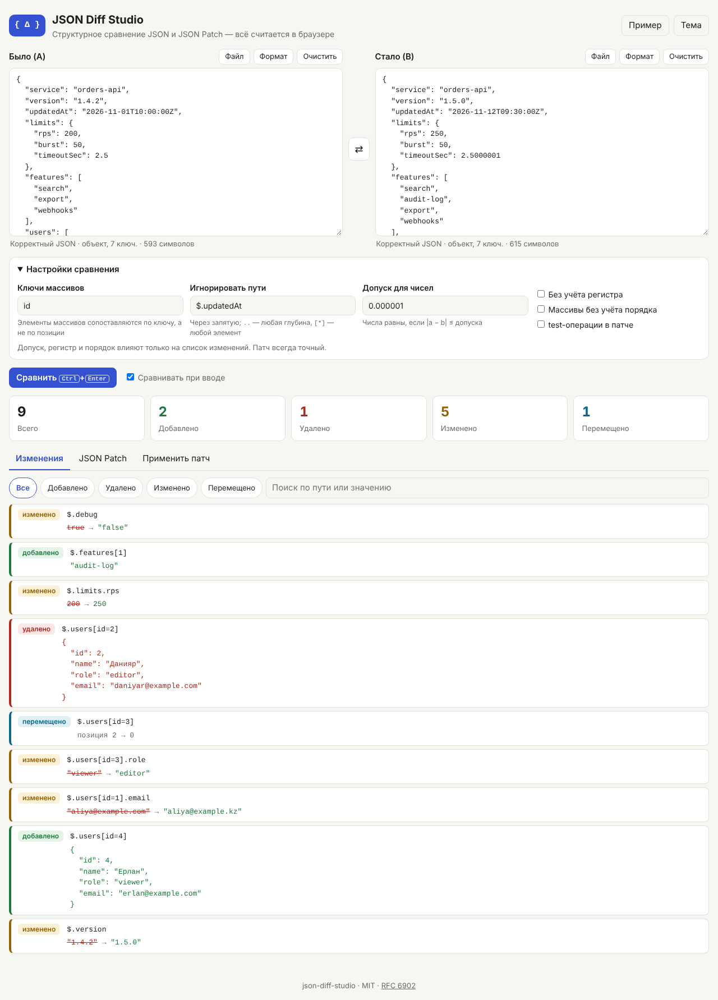

# json-diff-studio

**Структурное сравнение JSON и JSON Patch (RFC 6902).** Инструмент сравнивает два JSON-документа по смыслу, а не построчно. Он показывает, что добавлено, удалено, изменено и перемещено, с точными путями вида `$.users[id=7].email`, строит JSON Patch и применяет его.

Проект состоит из двух частей с одинаковой логикой:

- **CLI на Python** (только стандартная библиотека): отчёты в виде текста, JSON, JSON Patch или автономного HTML;
- **веб-песочница на JS**: работает прямо в браузере, без сервера и без отправки данных.

Совпадение результатов Python и JS проверяется общими фикстурами (`fixtures/cases.json`).



## Возможности

- **Умное выравнивание массивов.** Вставка в середину массива видна как одно `added`, а не как цепочка замен (используется LCS).
- **Сопоставление по ключу.** `--array-key id` сравнивает элементы массивов объектов по `id`, а не по позиции, и находит перестановки (`moved`). Правило можно ограничить путём: `--array-key '$.users=email'`.
- **Игнорирование путей.** Шаблоны вида `$.meta.updatedAt`, `$..timestamp` (любая глубина), `$.items[*].tmp`, `$.users[id=7]`, плюс короткая форма `--ignore-key etag`.
- **Мягкое сравнение для отчёта:** допуск для чисел (`--tolerance`), строки без учёта регистра (`--ignore-case`), массивы как мультимножества (`--ignore-order`).
- **JSON Patch (RFC 6902):**
  - построение патча с `move` для перестановок;
  - `test`-операции для безопасного применения (`--with-tests`);
  - полная реализация `add`, `remove`, `replace`, `move`, `copy` и `test`, атомарное применение, понятные ошибки с номером операции.
- **`verify`** проверяет, что патч действительно превращает A в B.
- **Форматы вывода:**
  - цветной текст;
  - JSON со сводкой и JSON Pointer для каждого изменения;
  - патч;
  - автономный HTML-отчёт с фильтрами, поиском и патчем.
- **Веб-песочница:** два редактора, загрузка файлов, форматирование, ошибки JSON с номером строки и столбца, авто-сравнение при вводе, фильтры, копирование и скачивание патча, вкладка «Применить патч», светлая и тёмная темы, адаптивная вёрстка.

## Пример вывода

```text
$ json-diff-studio diff examples/before.json examples/after.json -k id -i '$.updatedAt' -t 1e-6
~ $.debug: true → "false" (тип изменён)
+ $.features[1]: "audit-log"
~ $.limits.rps: 200 → 250
- $.users[id=2]: {"id": 2, "name": "Данияр", "role": "editor", "email": "daniyar@example.com"}
↕ $.users[id=3]: позиция 2 → 0
~ $.users[id=3].role: "viewer" → "editor"
~ $.users[id=1].email: "aliya@example.com" → "aliya@example.kz"
+ $.users[id=4]: {"id": 4, "name": "Ерлан", "role": "viewer", "email": "erlan@example.com"}
~ $.version: "1.4.2" → "1.5.0"

Итого: 9 — добавлено 2, удалено 1, изменено 5, перемещено 1
```

Пример HTML-отчёта: [`docs/report-example.html`](docs/report-example.html).

## Установка

Нужен Python 3.9+. Внешних зависимостей у CLI нет.

```bash
git clone https://github.com/mrsolo743-dot/json-diff-studio.git
cd json-diff-studio
python -m pip install -e .          # команда json-diff-studio
# или без установки: python -m json_diff_studio ...
```

## Запуск

```bash
# различия (текст)
json-diff-studio diff old.json new.json

# массивы по id, игнорировать служебные поля, допуск для чисел
json-diff-studio diff old.json new.json -k id --ignore-key updatedAt -t 1e-6

# HTML-отчёт
json-diff-studio diff old.json new.json -k id -f html -o report.html

# JSON Patch и обратно
json-diff-studio patch old.json new.json -k id --with-tests -o patch.json
json-diff-studio apply old.json patch.json -o result.json
json-diff-studio verify old.json new.json patch.json

# в CI: код 1, если есть различия
json-diff-studio diff expected.json actual.json --exit-code
```

| Команда | Что делает | Коды выхода |
|---|---|---|
| `diff A B` | список изменений (`-f text\|json\|patch\|html`) | 0, или 1 с `--exit-code` при различиях; 2 — ошибка |
| `patch A B` | JSON Patch, превращающий A в B | 0 / 2 |
| `apply DOC PATCH` | применить патч | 0 / 2 |
| `verify A B PATCH` | проверить, что патч даёт B | 0 — OK, 1 — нет |

Входной файл `-` означает stdin. Например: `curl … | json-diff-studio diff - expected.json`.

### Шаблоны путей

| Шаблон | Совпадает с |
|---|---|
| `$.meta.updatedAt` | ровно этот путь |
| `$..timestamp` | ключ `timestamp` на любой глубине |
| `$.items[*].tmp` | `tmp` в любом элементе `items` |
| `$.items[0]` | первый элемент |
| `$.users[id=7]` | элемент, сопоставленный по ключу `id` со значением 7 |
| `$["key with space"]` | ключ с особыми символами |

### Веб-песочница

ES-модулям нужен HTTP-сервер (через `file://` они не загрузятся):

```bash
python -m http.server 8000 --directory web
# открыть http://localhost:8000
```

## Тесты

```bash
python -m pip install pytest
python -m pytest                      # ядро, CLI, отчёты, общие фикстуры, свойства
node --test web/tests/core.test.mjs   # JS-порт (Node 18+), или: npm test
# сквозные тесты интерфейса (необязательно):
python -m pip install playwright && python -m playwright install chromium
python -m pytest tests/e2e
```

Свойство «`apply(a, make_patch(a, b)) == b`» проверяется на сотнях случайных документов в обеих реализациях.

## Структура

```
json-diff-studio/
├── json_diff_studio/       # пакет Python
│   ├── paths.py            # пути, JSON Pointer, шаблоны игнорирования
│   ├── diff.py             # ядро сравнения, LCS, сопоставление по ключу
│   ├── patch.py            # построение и применение JSON Patch
│   ├── report.py           # text / json / html
│   └── cli.py              # командная строка
├── web/                    # веб-песочница
│   ├── index.html
│   ├── css/style.css
│   ├── js/core.js          # JS-порт ядра
│   ├── js/app.js           # интерфейс
│   └── tests/core.test.mjs # node:test
├── fixtures/cases.json     # общие фикстуры Python ↔ JS
├── tools/gen_fixtures.py   # пересборка фикстур
├── tests/                  # pytest (+ tests/e2e — Playwright)
├── examples/               # before.json / after.json
└── docs/                   # скриншоты и пример отчёта
```

## Лицензия

MIT. См. [LICENSE](LICENSE).
